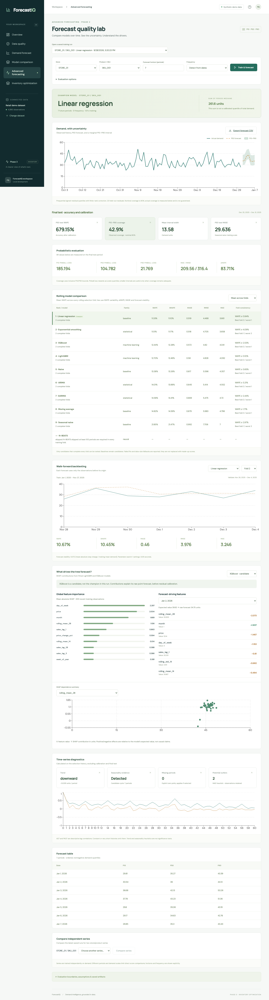
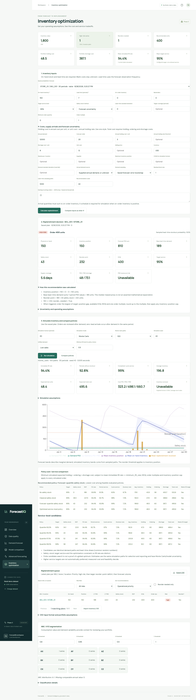

# ForecastIQ

**Demand forecasting and inventory planning, from historical sales to replenishment decisions.**

ForecastIQ is a full-stack analytics application for exploring retail demand, comparing forecasting models, estimating uncertainty, and turning saved forecasts into inventory recommendations. It combines a React dashboard with a FastAPI backend, chronological model evaluation, persistent forecast artifacts, and inventory simulation.

Upload a sales CSV or start with the included synthetic demo. Follow a store–product series through data validation, forecasting, model comparison, replenishment, and what-if analysis in one application.



[Quick start](#quick-start) · [Features](#features) · [How forecasting works](#how-forecasting-works) · [Inventory planning](#inventory-planning) · [Measured results](#measured-results) · [API](#api) · [Documentation](#documentation)

## Features

| Area | What you can do |
|---|---|
| Data ingestion | Upload CSVs, map column names, recognize Kaggle store-item columns, and validate dates, identifiers, duplicates, and demand values. |
| Exploration | Filter stores/products and dates; inspect demand, revenue where prices exist, trend, seasonality, missing periods, and outliers. |
| Forecasting | Compare statistical, regression, tree, and optional neural models on daily, weekly, or monthly series. |
| Evaluation | Use expanding or rolling backtests, bounded tree tuning, independent final tests, and saved comparison results. |
| Uncertainty | Inspect P10/P50/P90 forecasts, pinball loss, interval coverage, and interval width. |
| Explainability | View native TreeSHAP contributions for LightGBM and XGBoost, including global and per-forecast explanations. |
| Inventory | Calculate safety stock, reorder points, EOQ, constrained order quantities, and exposure to late supply receipts. |
| Simulation | Compare deterministic and Monte Carlo outcomes, replenishment policies, service targets, and what-if inputs. |
| Portfolio | Import inventory CSVs, review replenishment queues, inspect ABC/XYZ segmentation, and export recommendations. |
| Persistence | Restore saved runs and plans, reload model artifacts, export forecasts, and register offline forecast catalogs. |

The original baseline forecasting screens remain available alongside advanced forecasting and inventory optimization.

## Quick start

### Docker Compose

Install Docker with Compose, then run:

```sh
git clone https://github.com/ketan6210/Forecast-IQ.git
cd Forecast-IQ
cp .env.example .env
docker compose up --build -d
docker compose ps
```

Copy `.env.example` only on a fresh checkout; preserve an existing `.env`.

| Service | Default address |
|---|---|
| Dashboard | http://localhost:5173 |
| Interactive API documentation | http://localhost:8000/docs |
| Health check | http://localhost:8000/health |

Compose starts PostgreSQL 16, the FastAPI backend, and the frontend served by Nginx. Named volumes preserve the database, normalized datasets, and fitted artifacts. The published application ports bind to localhost.

Open the dashboard and choose **Use Demo Dataset**. No external account or API key is needed for the demo.

```sh
docker compose logs -f backend   # Inspect backend activity
docker compose stop            # Stop services and retain data
docker compose start           # Resume existing services
```

The default image includes statistical and tree models. To include CPU PyTorch for eligible N-BEATS training, set `INSTALL_NEURAL=true` in `.env`, then rebuild with `docker compose up --build -d`.

### Local development

Use **Python 3.12** and **Node.js 22.12 or newer**. The core Python environment is pinned in `requirements.lock.txt`; `requirements.txt` provides dependency ranges.

```sh
python3.12 -m venv .venv
source .venv/bin/activate
python -m pip install -r requirements.lock.txt
cp .env.example .env
uvicorn backend.app.main:app --reload --host 127.0.0.1 --port 8000
```

On Windows, activate the environment with `.venv\Scripts\activate`. Local development uses SQLite by default. Additive Alembic migrations run when the application starts.

In a second terminal:

```sh
cd frontend
npm ci
npm run dev
```

Vite forwards `/api` requests to `http://127.0.0.1:8000`. For optional neural training, install `requirements-neural.txt` into the Python environment.

**macOS:** LightGBM/XGBoost require a working OpenMP runtime. Install `libomp` with Homebrew if needed. Docker includes the required Linux runtime. See [Troubleshooting](#troubleshooting) for the existing workspace's library-path workaround.

### Configuration

| Variable | Purpose / default |
|---|---|
| `DATABASE_URL` | Local SQLite by default; Compose supplies a PostgreSQL connection. |
| `STORAGE_DIR` | Normalized CSVs and model artifacts; default `./storage`. |
| `CORS_ORIGINS` | Allowed frontend origins, comma-separated. |
| `MAX_UPLOAD_MB` | Upload limit; default `25` for local settings. |
| `MAX_DATASET_ROWS` | Dataset row limit; default `1000000`. |
| `MAX_TRAINING_PERIODS` | Maximum periods per advanced training request; default `5000`. |
| `BACKEND_PORT`, `FRONTEND_PORT` | Compose host ports; defaults `8000` and `5173`. |
| `INSTALL_NEURAL` | Include optional PyTorch in the Docker build; default `false`. |
| `POSTGRES_USER`, `POSTGRES_PASSWORD`, `POSTGRES_DB` | Compose database settings; example values are for local development. |

`MAX_UPLOAD_MB` is read by the local backend; to override it in Docker, also add it to the backend service's `environment` in `docker-compose.yml`. Back up the database and `STORAGE_DIR` together.

## Using the application

1. **Load data.** Choose the demo or upload a CSV. Configure custom columns and frequency before uploading when needed.
2. **Inspect quality.** Review missing values, duplicate handling, available series, and exploratory charts.
3. **Train a forecast.** Open **Advanced forecasting**, select a store/product, set the horizon, and choose evaluation options.
4. **Review evidence.** Inspect the selected model, backtest folds, final-test metrics, uncertainty bands, and available SHAP explanations.
5. **Save or export.** Restore a saved run, download forecast CSVs, or compare independently trained series.
6. **Plan inventory.** Select a saved forecast in **Inventory optimization** and enter stock, lead time, known arrivals, constraints, and available costs.
7. **Compare decisions.** Calculate replenishment, run simulations and policy comparisons, and evaluate what-if inputs without retraining.
8. **Review the portfolio.** Import inventory rows, filter the replenishment queue, inspect segmentation/KPIs, and export recommendations.

Inventory inputs are supplied by the user. The synthetic demo's inventory snapshots and the examples in reports are illustrative.

## Data format

```csv
date,store_id,product_id,category,units_sold,price,promotion
2025-01-01,STORE_01,SKU_001,Food,34,9.99,0
2025-01-02,STORE_01,SKU_001,Food,41,9.99,1
2025-01-03,STORE_01,SKU_001,Food,52,8.99,1
```

| Column | Requirement |
|---|---|
| `date` | Calendar date, with daily, consistently anchored weekly, or month-start/month-end observations. |
| `store_id`, `product_id` | Nonempty identifiers; leading zeros are preserved. Custom mappings and `sku_id` alias are supported. |
| `units_sold` | Finite, nonnegative demand. Missing observations are reported. |
| `price` | Optional; observed values must be finite and positive. Revenue is unavailable where price is missing. |
| `category`, `region` | Optional dimensions for analysis. |
| `promotion`, `holiday`, `discount` | Optional event indicators and discount fraction. |
| `inventory` | Optional nonnegative snapshot for the baseline inventory-gap display; excluded from forecasting features. |

For a single series with no store/product columns, use `__single__` as the mapping for the absent identifier. You can explicitly select up to 20 additional numeric predictors. Unselected extra columns are not automatically used as predictors.

The Kaggle Store Item Demand Forecasting columns `date,store,item,sales` are recognized automatically. Its 913,000-row `train.csv` fits the default row limit. Upload historical sales, not `test.csv` or `sample_submission.csv`, which do not contain historical sales labels.

Exact normalized duplicates are removed and counted; conflicting records are rejected. Missing demand blocks forecasting unless you explicitly confirm that it means zero sales. Weekly/monthly inputs must already contain the intended period totals: selecting a frequency does not aggregate daily data.

The bundled demo contains **4,380 synthetic rows: 2 stores × 6 products × 365 days**. Regenerate it with `python scripts/generate_demo.py`. Imported datasets and runtime storage are excluded from Git; the demo and checked-in experiment reports are included.

## How forecasting works

### Models

| Family | Models |
|---|---|
| Baselines | Naive, seasonal naive, seven-period moving average |
| Regression | Linear regression with causal features and training-only preprocessing |
| Statistical | ARIMA, SARIMA, ETS |
| Boosted trees | LightGBM, XGBoost |
| Neural, optional | Compact N-BEATS implementation using PyTorch |

Models train independently for each selected series. Advanced forecasting supports **1–90 periods**, **2–5 chronological folds**, expanding or rolling history, and bounded randomized tuning for tree models. N-BEATS needs PyTorch and at least **512 periods in every training fold**; ineligible or failed candidates report their reasons while other candidates continue.

Supervised features include demand lags, shifted rolling statistics, calendar fields, observed prices, event indicators, and selected numeric predictors. Features never cross series boundaries. Preprocessing is fitted only on the training history available at each forecast origin.

### Selection and uncertainty


For horizon `h` and `k` folds, the minimum history is:

```text
60 + (k + 1) × h + max(20, 2h) periods
```

The final `h` observations are held out for testing, with a separate calibration block before them. Candidate selection and tuning finish before either is used. Baselines can win; the platform does not assume the most complex model is best.

P10/P50/P90 forecasts use signed errors from the calibration block. Point and probabilistic metrics include MAE, RMSE, WAPE, sMAPE, MASE, pinball loss, observed coverage, and mean interval width. Undefined metrics remain explicit. Quantiles are nonnegative and ordered, but empirical intervals do not guarantee future coverage.

Future prices and additional numeric predictors remain at their last observed training values; future event flags are zero. Planned future covariate uploads are not implemented. Tree explanations describe raw model predictions before clipping and residual calibration.

See the [technical guide](docs/technical-guide.md) for model settings, feature definitions, metric formulas, calibration details, and artifact metadata.

## Inventory planning



Inventory planning consumes an existing saved forecast and user-supplied operational inputs.

| Calculation | Behavior |
|---|---|
| Inventory position | On-hand + on-order − backorders. |
| Lead-time demand | Sum of forecast P50 values over the supplier lead time, measured in observation periods. |
| Safety stock | No buffer, demand variability, demand plus lead-time variability, or sampled aggregate-demand quantiles. |
| Reorder point | Lead-time demand + safety stock. |
| EOQ | `sqrt(2 × annual demand × ordering cost / annual holding cost per unit)` when inputs are available. |
| Practical order | Applies reorder triggers, coverage, EOQ where available, minimum quantities, order multiples, and optional position caps. |
| Receipt-aware risk | Compares demand with stock available in each period; a late receipt cannot erase an earlier shortage. |

Immediate supply shortfalls and suggested expedite quantities are separate from new purchase quantities. Missing cost inputs produce unavailable cost results with reasons rather than invented values.

Simulation supports fixed P50 demand or **100–1,000 Monte Carlo paths**, scheduled receipts, variable lead times, lost sales/backorders, and inventory/service/cost distributions. Policy comparison searches a finite candidate set for the lowest simulated expected operating cost meeting a minimum mean fill rate, using common random numbers. Operating cost includes holding, ordering, and shortage costs; purchasing cost and profit are excluded.

Portfolio tools support up to **1,000 inventory rows per batch**, CSV imports, saved plans, ABC/XYZ segmentation, and exports. Shared allocation combines up to **200 saved plans at one location** under a purchasing budget, available capacity, or both. It maximizes user-weighted allocated units while respecting recommendations, minimum order quantities, order multiples, and position caps. Decisions can be saved, restored, and exported.

Read the [inventory methodology](docs/phase3-methodology.md) and [receipt-timing/catalog update](docs/phase3-continuation-2026-10-13.md) for formulas, assumptions, and regression evidence.

The [November 11 implementation and validation report](docs/phase3-allocation-2026-11-11.md) defines the allocation contract and current phase status. The Phase 1 quality label now correctly describes mapped required fields, including optional-price and single-series uploads.

### Register saved catalog forecasts

Offline batch runs can be registered without retraining after uploading the same sales dataset to the app:

```sh
python scripts/import_forecast_catalog.py --source storage/kaggle-batch \
  --dataset-id <uploaded-dataset-id> --dry-run
python scripts/import_forecast_catalog.py --source storage/kaggle-batch \
  --dataset-id <uploaded-dataset-id>
```

Use the application's database and storage configuration. The importer validates histories, fingerprints, forecast/calibration records, and artifact checksums. Repeated imports skip intact matching runs. Only import trusted locally generated catalogs; serialized model files are not a public upload format. Checkpoints and fitted artifacts must be generated locally; they are excluded from this repository.

## Architecture and project structure

| Layer | Technology |
|---|---|
| Dashboard | React 19, TypeScript, Vite, Recharts, Lucide icons |
| API and validation | FastAPI, Pydantic |
| Data and modeling | pandas, NumPy, scikit-learn, statsmodels, LightGBM, XGBoost, optional PyTorch |
| Persistence | SQLAlchemy, Alembic, PostgreSQL; SQLite for local development/tests |
| Delivery | Docker Compose, Nginx |
| Verification | pytest, Ruff, TypeScript, Playwright |

```text
Forecast-IQ/
├── backend/app/
│   ├── api/                 # HTTP endpoints
│   ├── data/                # Loading, validation, preprocessing, diagnostics
│   ├── features/            # Causal time-series and covariate features
│   ├── forecasting/         # Original baseline forecasting workflow
│   ├── models/              # Advanced model implementations
│   ├── evaluation/          # Backtesting, selection, metrics, calibration
│   ├── explainability/      # Native TreeSHAP
│   ├── inventory/           # Formulas, policies, recommendations, analytics
│   ├── simulation/          # Demand paths and inventory simulation
│   ├── services/            # Training, artifacts, catalog import, inventory
│   └── db/ + schemas/       # Persistence and request contracts
├── backend/migrations/      # Database migrations
├── frontend/src/            # Dashboard pages and components
├── frontend/e2e/            # Browser workflow tests
├── data/demo/               # Included synthetic retail dataset
├── notebooks/               # EDA and baseline experiments
├── scripts/                 # Reproducible experiments and catalog tools
├── tests/                   # Python unit and integration tests
├── docs/                    # Methodology, reports, results, screenshots
└── docker-compose.yml       # PostgreSQL + API + frontend
```

Normalized CSVs and fitted artifacts live under `STORAGE_DIR`; database records retain datasets, runs, plans, and analysis results. Artifacts have manifests and checksums for corruption detection. Training runs in a worker thread, with one advanced training request at a time per process.

## Measured results

The checked-in [Kaggle batch report](docs/kaggle-batch/README.md) records **500 store–item series** trained on 913,000 historical rows, producing **45,000 future forecast rows**. The saved run compared six candidates per series using three chronological 90-day folds, separate calibration, and an independent historical test.

| Historical test measure | Recorded result |
|---|---:|
| Aggregate WAPE | 14.81% |
| MAE | 8.09 units |
| RMSE | 10.53 units |
| sMAPE | 16.20% |
| P10–P90 interval coverage | 73.91% |
| Selected LightGBM / XGBoost models | 441 / 59 series |

These metrics cover **October 3–December 31, 2017**, not the unlabeled January–March 2018 competition test data. Coverage fell below the nominal 80%. No Kaggle leaderboard score, competition submission, or guaranteed business savings is claimed.

The report includes [forecast exports](docs/kaggle-batch/predictions-with-intervals.csv), [historical predictions](docs/kaggle-batch/historical-test-predictions.csv), [per-series results](docs/kaggle-batch/series-results.csv), and [verification evidence](docs/kaggle-batch/verification.json). These are recorded experiments, not new training performed for this repository publication. Reproduction requires the original dataset and a local training run; see the report and `scripts/run_kaggle_batch.py --help`.

## API

Open `/docs` on the backend for complete interactive request/response schemas. Direct backend routes have no `/api` prefix; requests through the frontend use `/api`.

| Method | Route | Purpose |
|---|---|---|
| GET | `/health` | API and database readiness |
| POST | `/datasets/demo`, `/datasets/upload` | Load demo or upload CSV |
| GET | `/analytics/{dataset_id}` | Filtered exploratory analysis |
| POST | `/forecast/train` | Train, evaluate, calibrate, and save an advanced run |
| POST | `/forecast/predict` | Reload a saved forecast model and calibrator |
| GET | `/forecast/models`, `/forecast/runs/{run_id}` | List or restore saved runs |
| GET | `/forecast/backtest`, `/forecast/model-comparison` | Evaluation evidence |
| GET | `/forecast/explainability`, `/forecast/export/{run_id}` | Tree explanations or CSV export |
| POST | `/inventory/optimize`, `/inventory/batch`, `/inventory/import` | Individual or batch inventory plans |
| POST | `/inventory/allocate` | Joint purchasing budget/capacity allocation |
| GET | `/inventory/allocations`, `/inventory/allocations/{id}` | List or restore saved allocations |
| GET | `/inventory/allocations/{id}/export` | Allocation CSV |
| POST | `/inventory/simulate`, `/inventory/policy-comparison`, `/inventory/scenario` | Simulation and comparisons |
| GET | `/inventory/recommendations`, `/inventory/kpis`, `/inventory/export` | Queue, portfolio metrics, and CSV |

Example using default backend ports:

```sh
curl -X POST http://localhost:8000/datasets/demo

# Replace <dataset-id> with the ID returned above.
curl -X POST http://localhost:8000/forecast/train \
  -H 'Content-Type: application/json' \
  -d '{"dataset_id":"<dataset-id>","store_id":"STORE_01","product_id":"SKU_001","horizon":28,"folds":3,"frequency":"daily","tune":true}'

# Replace <run-id> with the saved forecast run ID.
curl -X POST http://localhost:8000/forecast/predict \
  -H 'Content-Type: application/json' \
  -d '{"run_id":"<run-id>"}'
```

The [technical guide](docs/technical-guide.md#api-and-artifacts) includes more endpoint details and inventory request examples.

## Testing

From the project root with the Python environment active:

```sh
python -m pytest -q
ruff check backend scripts tests
```

From `frontend/`:

```sh
npm ci
npm run build
npx playwright install chromium
npm test
```

Playwright starts its own API/Vite servers on ports 8000/5173 and expects the Python environment at `.venv`. Stop conflicting local servers first. To test an already running stack, set `E2E_EXTERNAL=1` and `E2E_BASE_URL` to its frontend address.

The Python suite covers validation, causal features, chronology, model fitting/fallbacks, metrics, quantiles, serialization, SHAP reconstruction, inventory formulas, supply timing, catalog imports, and API persistence. Browser tests cover forecasting, inventory, exports, saved-state restoration, delayed responses, and mobile layouts. Neural tests skip explicitly if optional PyTorch is absent.

The **November 11, 2026** checks cover the Phase 1 label regression, joint allocation, and demand validation. See the [current implementation report](docs/phase3-allocation-2026-11-11.md) for results and evidence. The [November 5 publication check](docs/publication-verification.md) and [October 13 verification](docs/phase3-continuation-2026-10-13.md#verification) remain historical records.

## Troubleshooting

- **Ports already in use:** edit `BACKEND_PORT`/`FRONTEND_PORT` for Compose. For local development, change Uvicorn's port and run Vite with a matching `API_TARGET`, for example `API_TARGET=http://127.0.0.1:8010 npm run dev -- --port 5180`.
- **OpenMP library errors on macOS:** install/configure `libomp` or use Docker. In the existing Python 3.12 environment, tests also run with `DYLD_LIBRARY_PATH="$PWD/.venv/lib/python3.12/site-packages/sklearn/.dylibs" .venv/bin/python -m pytest -q` when that directory contains `libomp.dylib`.
- **Insufficient history or skipped models:** reduce the horizon/folds, supply more observations, or install PyTorch for eligible N-BEATS runs. The UI reports candidate-specific reasons.
- **Missing-demand validation:** inspect data quality and explicitly choose zero only when missing periods mean zero sales.
- **Unavailable EOQ or cost metrics:** provide the required annual demand, holding, ordering, or shortage-cost inputs.
- **Saved artifacts unavailable:** restore both the database and artifact storage. A database backup alone does not contain fitted models.

## Scope and limitations

ForecastIQ is a local portfolio/research application. It does not include authentication, tenant isolation, a durable training job queue, production monitoring, or automated retraining.

Forecasts are independent per series. Global/hierarchical reconciliation, cold-start modeling, intraday/irregular frequencies, planned future covariates, and stockout-censored demand correction are not implemented. Empirical uncertainty intervals and simulated inventory service levels depend on their assumptions and must be checked on representative data. Targets above P90 under quantile interpolation rely on extrapolation.

Inventory policy selection uses a finite candidate set. Shared allocation is one purchasing decision at one location; it does not jointly simulate recurring multi-SKU policies or optimize transfers between warehouses. Purchasing budgets cover unit purchase costs; capacity means space reserved for new orders after existing stock and committed receipts. Demo inventory costs and quantities are assumptions; reported simulation outcomes are not measured commercial savings.

The November 11 demand validation recomputed 45,000 saved holdout predictions from 500 Kaggle series. P10–P90 coverage was **73.91% against an 80% target**. Observed supplier lead times, fill rate, and cycle service remain **unverified** because the required operational records are unavailable. See the [validation report](docs/phase3-allocation-2026-11-11.md) for scope and source provenance.

## Documentation

| Guide | Contents |
|---|---|
| [Technical guide](docs/technical-guide.md) | Detailed forecasting methods, metrics, artifact contracts, and historical experiments |
| [Inventory methodology](docs/phase3-methodology.md) | Safety stock, replenishment, simulation, policies, and segmentation |
| [November 11 implementation and validation](docs/phase3-allocation-2026-11-11.md) | Current phase status, shared allocation, demand coverage, and dated checks |
| [Inventory walkthrough](docs/phase3-measured-results.md) | Recorded forecast-to-inventory examples |
| [Receipt timing and catalog integration](docs/phase3-continuation-2026-10-13.md) | October 13 inventory behavior and catalog verification |
| [Full Kaggle batch](docs/kaggle-batch/README.md) | 500-series experiment, exports, provenance, and reproduction |
| [Completion report](docs/completion-report.md) | Earlier end-to-end checks and known limitations |
| [Publication verification](docs/publication-verification.md) | Checks performed for this GitHub snapshot |
| [Synthetic demo](data/demo/README.md) | Dataset generation and interpretation |

Historical audits describe the project at their recorded dates. The October 13 update documents the supply-timing and catalog-registration fixes made after the October 12 audit.
