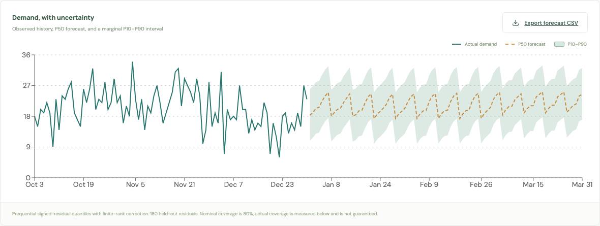

# Kaggle data: Store 1 / Item 1 result

**Full dataset result:** The subsequent [500-series batch report](../kaggle-batch/README.md)
includes all 45,000 predictions in [submission.csv](../kaggle-batch/submission.csv),
with 14.81% aggregate historical-test WAPE. Its fixed six-model configuration differs
from this tuned single-series example.

**Upload compatibility update:** ForecastIQ now recognizes the original Kaggle
`date,store,item,sales` columns automatically with default settings. A subsequent
browser check uploaded all 913,000 original rows successfully after changing datasets;
see the [verification record](automatic-upload-verification.json) and
[successful upload screenshot](automatic-upload-success.png).

The automatically recognized upload now also has a saved **Store 1 / Item 1,
90-day LightGBM forecast**. Its historical-test WAPE is 24.40%, MAE is 4.96 units/day,
and the sum of daily P50 predictions is 1,914.78 units. Reloading the browser restored
the saved run, and loading the model artifact reproduced its forecast exactly.

[Open the latest dataset](http://localhost:5180/?dataset=ce584990-809f-468f-80fa-727d34d4a0de),
choose **Advanced forecasting**, and select **1 / 1 · LightGBM** under
**Open a saved training run**. Download the [latest daily forecast](automatic-upload-forecast.csv),
inspect its [chart](automatic-upload-forecast.png), or read the
[workflow verification](automatic-upload-workflow.json) and
[complete run](automatic-upload-forecast.json).

Run on 2026-10-05 using the three user-provided CSV files. The complete `train.csv` was uploaded through the ForecastIQ browser workflow. This detailed forecast covers **one of the 500 store–item series**, matching 90 of the 45,000 rows in `test.csv`.

[Open the dataset in ForecastIQ](http://localhost:5180/?dataset=e2fb7389-e85b-48c8-a8be-17ed19ec6879). Choose **Advanced forecasting** and select the saved Store 1 / Item 1 run. [Open the illustrative inventory plan](http://localhost:5180/?dataset=e2fb7389-e85b-48c8-a8be-17ed19ec6879&view=inventory&plan=b142ee7b-6a66-4a62-a477-d67cfc2d964d).

## Data checks

- `train.csv`: 913,000 rows; 10 stores × 50 items; 1,826 daily observations per series, 2013-01-01 through 2017-12-31.
- No duplicate store/item/date records, missing sales or missing calendar dates.
- No price column is supplied, so revenue and inventory cost remain unavailable.
- `test.csv`: 45,000 future rows for 2018-01-01 through 2018-03-31, with no sales labels.
- `sample_submission.csv`: ID/output format template. Its constant sample sales are not actual demand and were not used for training or accuracy scoring.

## Measured model result

All 10 candidates completed. **lightgbm** was selected using mean WAPE over three chronological 90-day selection folds. Training took 13.95 seconds. Calibration used a separate 180-day period. Final historical testing covered **2017-10-03 through 2017-12-31**.

| Metric | Result |
|---|---:|
| Selection-fold mean WAPE | 18.70% |
| Final historical-test WAPE | 24.40% |
| Final historical-test MAE | 4.96 units/day |
| Final historical-test RMSE | 6.07 units/day |
| Final historical-test sMAPE | 24.66% |
| Final historical-test MASE | 1.0133 |
| Observed P10–P90 coverage | 75.56% |
| Mean interval width | 15.12 units |

WAPE is an error measure, not an accuracy percentage. The observed coverage falls below the nominal 80%. The application works on this dataset, but this forecast leaves room for accuracy and calibration improvements. These measurements use held-out 2017 sales; the supplied 2018 test file cannot be scored without its true sales.

## January–March 2018 forecast

The production model refits on all 1,826 observations for Store 1 / Item 1. The sum of its 90 daily P50 forecasts is **1,914.78 units**, or **21.28 units/day**. The sum is not a calibrated quantile of total demand.

| Month | Days | Sum of daily P50 forecasts |
|---|---:|---:|
| 2018-01 | 31 | 644.20 units |
| 2018-02 | 28 | 586.19 units |
| 2018-03 | 31 | 684.39 units |

## Illustrative inventory result

Inventory inputs are not present in these Kaggle files. This example explicitly assumes **100 units on hand, a 7-day lead time, a 95% service target, 14-day target coverage, and zero on-order stock/backorders**. Costs and selling prices were left unknown.

| Calculated measure | Result |
|---|---:|
| Seven-day expected demand | 149.85 units |
| Safety stock | 27.20 units |
| Reorder point | 177.05 units |
| Recommended order | 225 units |
| Simulated immediate fill rate, 500 paths | 97.32% |

The inventory calculation is a scenario based on those assumptions, not a finding about the stores’ actual stock or observed savings.

## Saved artifacts

- [Daily forecast: date, P10, P50, P90](store-1-item-1-forecast.csv)
- [Predictions matched to Store 1 / Item 1 test IDs](store-1-item-1-kaggle-test-predictions.csv) — 90 rows for this series; this is not a complete 45,000-row competition submission.
- [Historical test predictions and actuals](historical-test-predictions.csv)
- [Monthly forecast totals](monthly-forecast.csv)
- [All 10 model rankings](model-comparison.csv)
- [Full run, folds, metrics, explanations and configuration](store-1-item-1-run.json)
- [Source summary and SHA-256 hashes](source-summary.json)
- [Inventory inputs and calculation](illustrative-inventory.json)
- [Monte Carlo simulation](illustrative-simulation.json)

Saved forecast reload reproduced the predictions exactly. The saved inventory page restored successfully with no browser page errors. Local checks recomputed WAPE, MAE and interval coverage from the stored historical predictions and verified a one-to-one match with the selected 90 rows of `test.csv`.

Dataset ID: `e2fb7389-e85b-48c8-a8be-17ed19ec6879`. Forecast run ID: `1e763976-db3d-4ce7-aafd-963c93540909`.
